```{r}
# Packages used only to display saved figures and format result summaries
library(knitr)
library(kableExtra)
```

## Project Overview

- **Data:** Rhode Island Department of Health Hospital Discharge Data
- **Population:** Hospital discharge records from 2018
- **Part II:** Ten plots and one animated plot
- **Part III:** Predictive models for hospital charges and length of stay


## Visualization 1: Admissions by Month

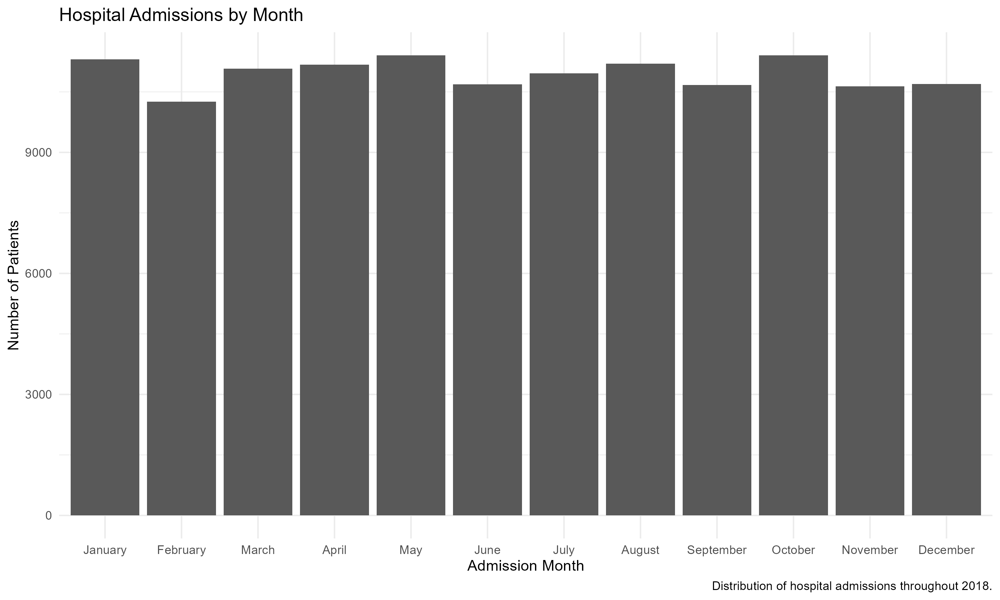{width="85%"}

## Visualization 2: Admissions by Gender

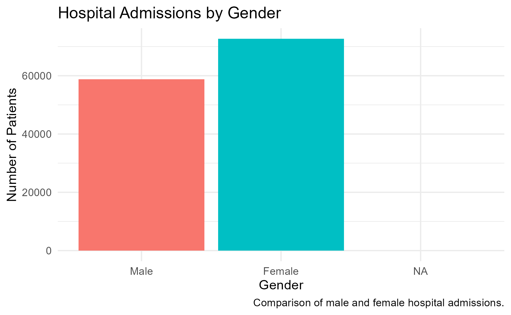{width="75%"}

## Visualization 3: Distribution of Patient Ages

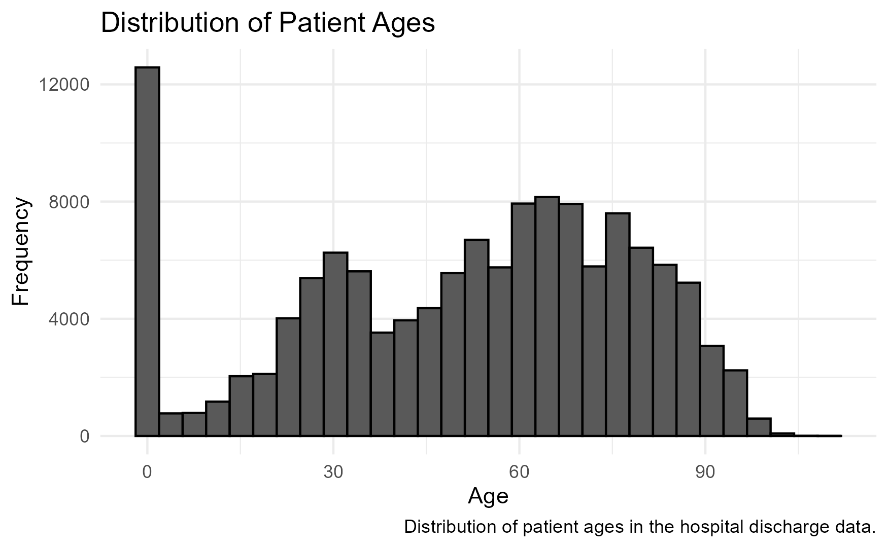{width="85%"}

## Visualization 4: Patient Age by Gender

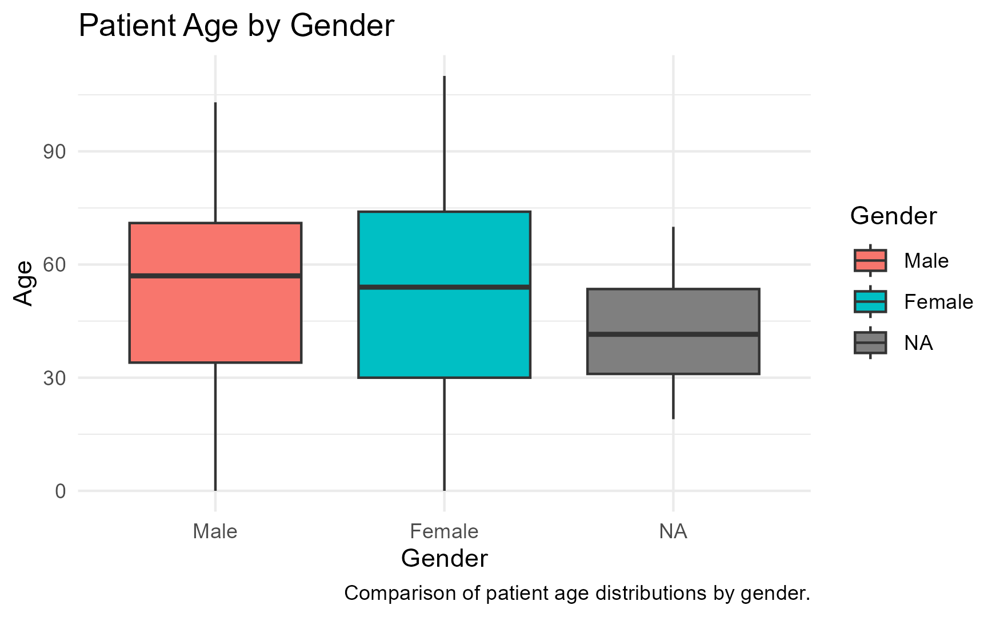{width="80%"}

## Visualization 5: Average Length of Stay by Month

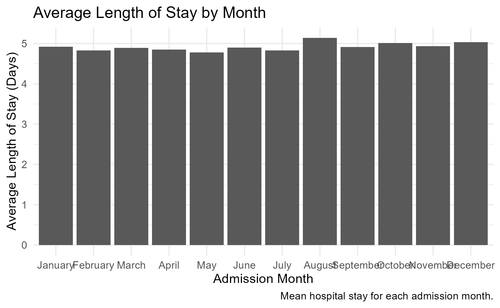{width="85%"}

## Visualization 6: Distribution of Hospital Charges

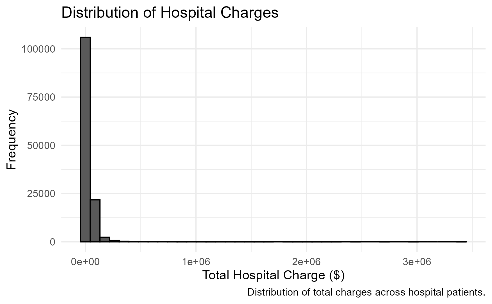{width="85%"}

## Visualization 7: Hospital Charges by Gender

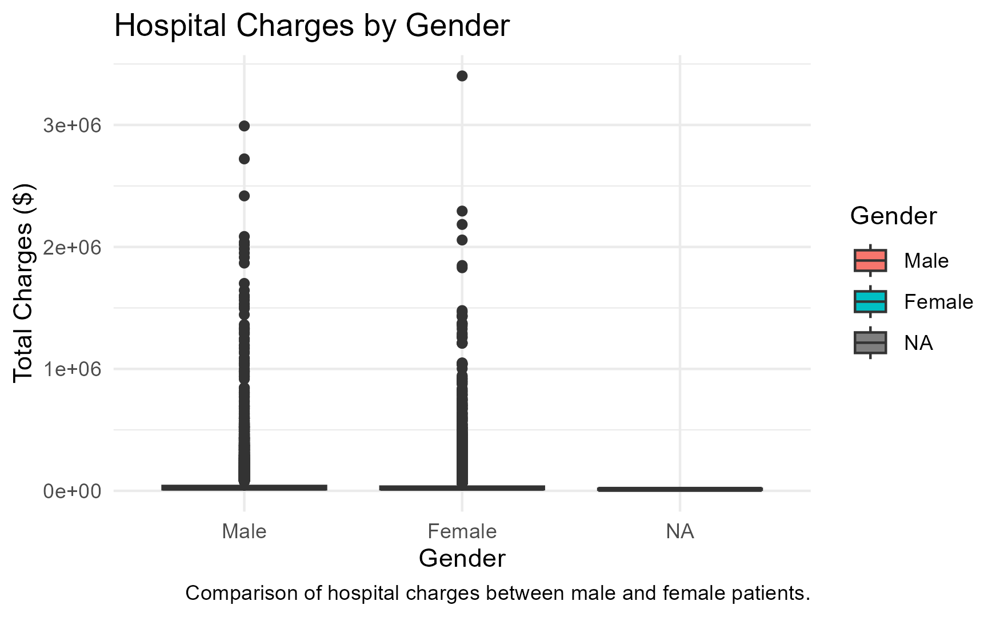{width="85%"}

## Visualization 8: Average Hospital Stay by Season

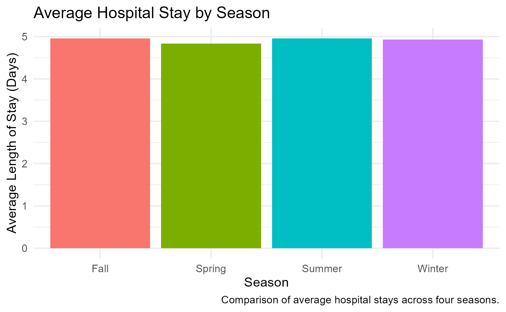{width="85%"}

## Visualization 9: Patient Age vs. Hospital Charges

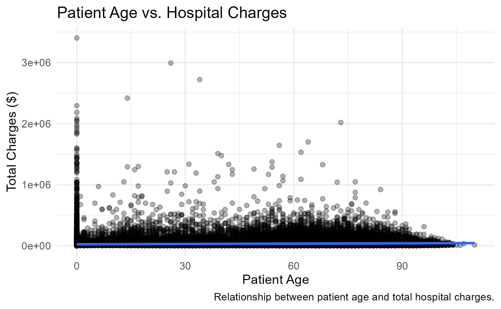{width="85%"}

## Visualization 10: Monthly Admissions by Gender

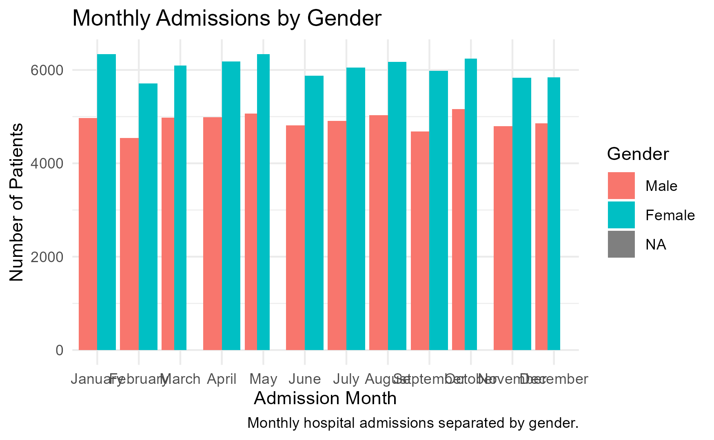{width="85%"}

## Animated Visualization: Monthly Admissions

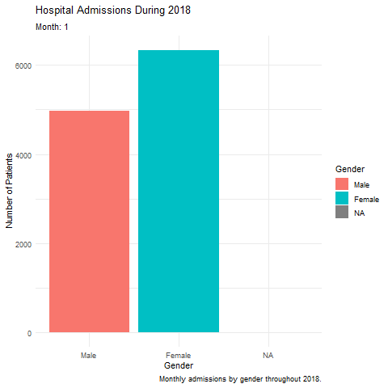{width="75%"}

## Part II: Main Visualization Takeaways

- Monthly admissions can be compared to identify busier and quieter periods.
- Age, length of stay, and hospital charges show different distributions across patients.
- The gender comparisons help show whether admission counts, ages, or charges differ between groups.
- The seasonal and monthly plots provide a way to look for patterns over the year.

**Replace or supplement these bullets with the specific patterns you observed in your plots.**

## Part III: Predictive Modeling — Question 5

### First target: hospital charges

The assignment defines the first target as:

- `low`: total charge (`tot`) is below the median total charge.
- `high`: total charge is at or above the median total charge.

**Final model selected:** `[Enter Decision Tree or Random Forest]`

**Cross-validation accuracy:** `[Enter best 5-fold CV accuracy]`

**Testing accuracy:** `[Enter test accuracy]`

**Confusion matrix:**

```text
              Reference
Prediction    low    high
low           [ ]    [ ]
high          [ ]    [ ]
```

**Interpretation:** Explain how accurately the selected model classified patients into the low- and high-charge groups. Mention whether one class was harder to predict.

::: notes
Use the actual confusion matrix and accuracy printed by your Q5 R code. Do not use the example blanks as results. The supplied Rmd has a typo in the Random Forest selection branch (inal_model_name); correct it to final_model_name before running the analysis.
:::

## Part III: Question 5 — Model Selection

- The two models compared were a decision tree (`rpart`) and a random forest (`ranger`).
- Both were tuned using 5-fold cross-validation.
- The final model should be the model with the higher cross-validation accuracy.
- Its final performance is evaluated on the held-out test data.

**Why this model was selected:** `[Explain the comparison using your actual results.]`

## Part III: Predictive Modeling — Question 6

### Second target: length of hospital stay

For the second analysis, the target is based on `los`:

- `short`: length of stay is below the median LOS.
- `long`: length of stay is at or above the median LOS.

The original `los` variable is removed from the predictors after creating the target, preventing the model from using the answer as an input.

**Input variables:** `age`, `sex`, `raceethn`, `provider`, `moa`, `mod`, `admtype`, and `campus`.

## Part III: Question 6 — Results

**Median length of stay:** `[Enter median_los]`

**Final model selected:** `[Enter Decision Tree or Random Forest]`

**Cross-validation accuracy:** `[Enter best 5-fold CV accuracy]`

**Testing accuracy:** `[Enter test accuracy]`

**Confusion matrix:**

```text
              Reference
Prediction    short   long
short          [ ]    [ ]
long           [ ]    [ ]
```

**Interpretation:** Describe how well the model distinguished short and long hospital stays. Compare its performance with the charge model from Question 5.

## Part III: Question 6 — Model Comparison

| Model | Best 5-fold CV accuracy |
|:--|:--:|
| Decision Tree | `[Enter accuracy]` |
| Random Forest | `[Enter accuracy]` |

**Selected model:** `[Enter model]`

**Reason for selection:** `[State which model performed better and refer to the comparison.]`

## Part III: Question 7 — Summary and Comments

The predictive modeling section used two binary outcomes: total hospital charges and length of hospital stay. For each outcome, a decision tree and random forest were trained and compared using 5-fold cross-validation. The model with the higher cross-validation accuracy was selected and evaluated on the test data.

**Complete this summary with your actual findings:**

- For hospital charges, `[model]` performed best, with a test accuracy of `[value]`.
- For length of stay, `[model]` performed best, with a test accuracy of `[value]`.
- The results suggest that `[describe what the accuracy and confusion matrices indicate]`.
- One limitation is the 10% training / 90% testing split, which leaves a relatively small portion of the data for model training.

## Challenges and Limitations

- The data required cleaning and handling missing values before modeling.
- Rows with blank `raceethn` or `admtype` values were excluded from the predictive modeling data.
- The second target was derived from `los`, so `los` was removed from the predictor variables to avoid target leakage.
- The 10:90 training/testing split follows the assignment instructions, but provides less training data than a more typical split.

## Conclusion

- The visualizations summarize admission patterns, patient characteristics, hospital stays, and charges in 2018.
- The predictive models examine whether patient and admission information can classify charge levels and length-of-stay groups.
- The final conclusions should be based on the observed plots, cross-validation comparisons, and test confusion matrices.

## Questions

Thank you!
