## Project Overview

- Introduces the hospital discharge dataset and the goals of the visualization and modeling sections.

- **Data:** Rhode Island Department of Health Hospital Discharge Data
- **Population:** Hospital discharge records from 2018
- **Part II:** Ten visualizations and one animated visualization
- **Part III:** Decision tree and random forest models for hospital charges and length of stay

## Visualization 1: Admissions by Month

- Shows how the number of hospital admissions changes from month to month.

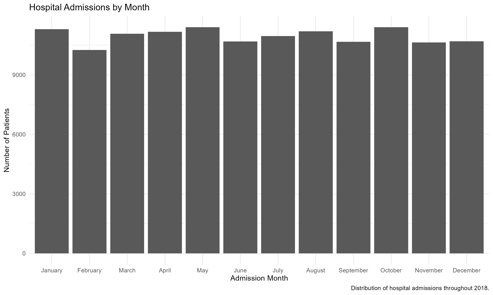{width="85%"}

## Visualization 2: Admissions by Gender

- Compares the number of admissions across gender groups.

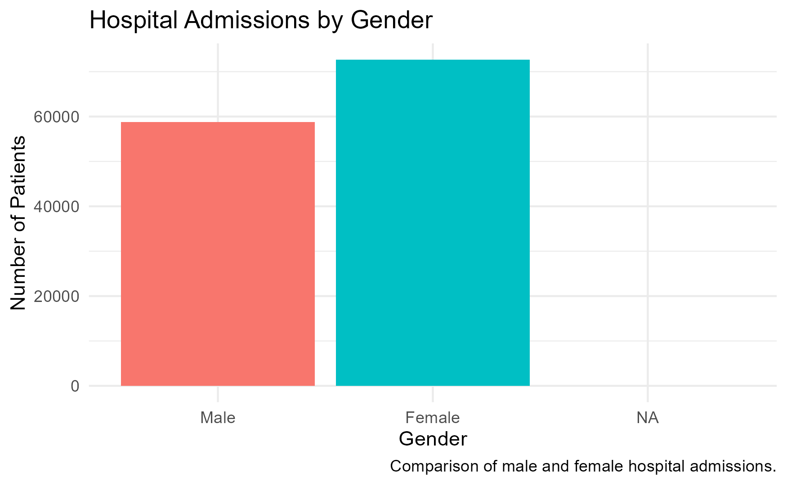{width="75%"}

## Visualization 3: Distribution of Patient Ages

- Summarizes the ages of patients included in the 2018 discharge records.

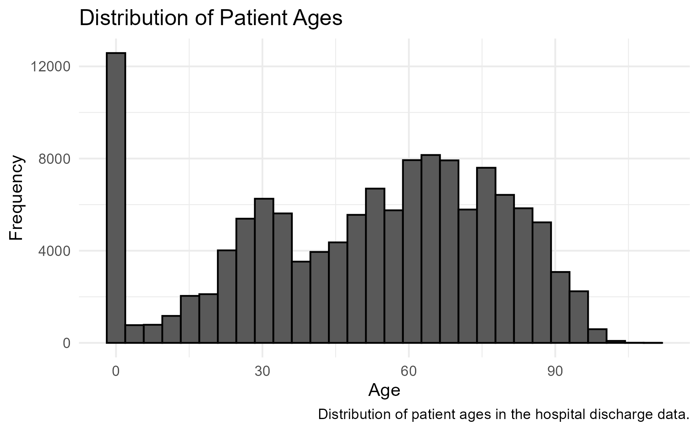{width="85%"}

## Visualization 4: Patient Age by Gender

- Compares patient age distributions between gender groups.

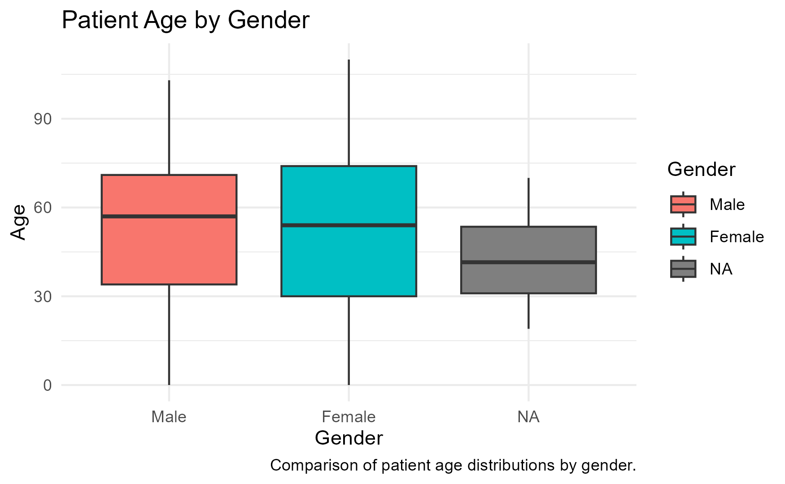{width="80%"}

## Visualization 5: Average Length of Stay by Month

- Shows how average hospital stay varies across the months of the year.

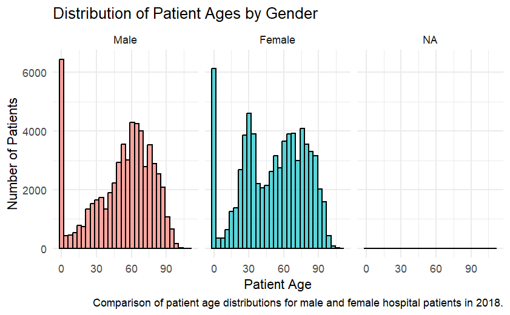{width="85%"}

## Visualization 6: Distribution of Hospital Charges

- Displays the spread of total hospital charges across discharge records.

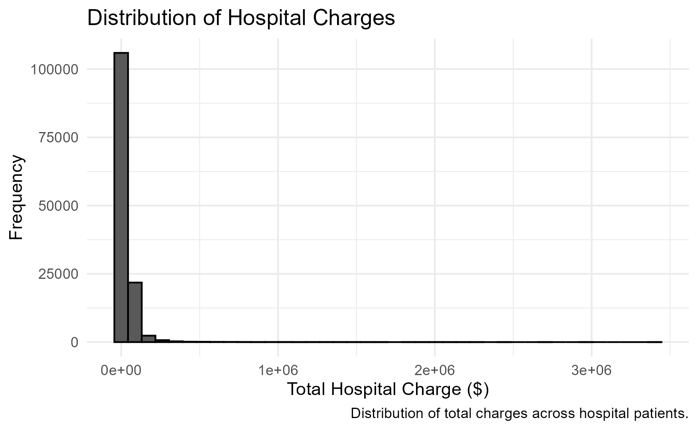{width="85%"}

## Visualization 7: Hospital Charges by Gender

- Compares hospital charges for patients in each gender group.

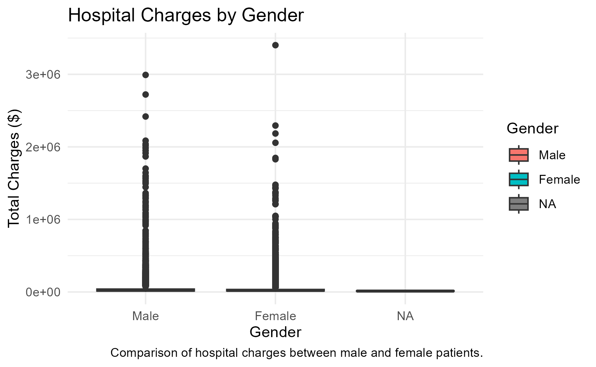{width="85%"}

## Visualization 8: Average Hospital Stay by Season

- Compares average length of stay across the seasons.

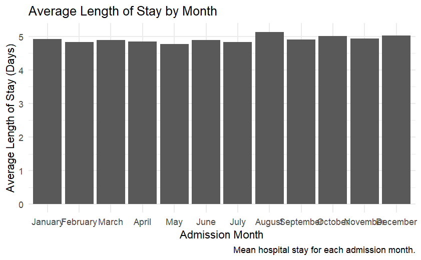{width="85%"}

## Visualization 9: Patient Age vs. Hospital Charges

- Examines the relationship between patient age and hospital charges.

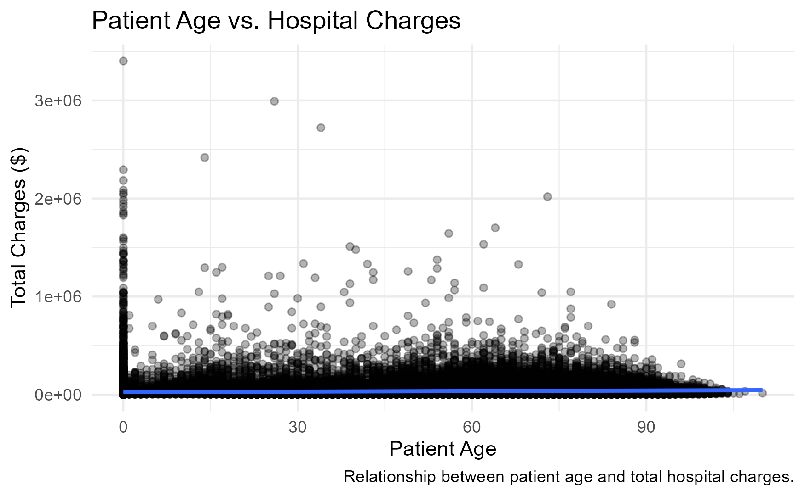{width="85%"}

## Visualization 10: Monthly Admissions by Gender

- Compares monthly admission patterns across gender groups.

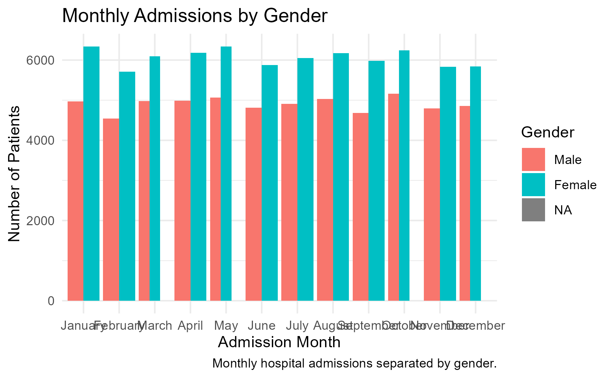{width="85%"}

## Animated Visualization: Monthly Admissions

- Animates the month-by-month pattern in hospital admissions.

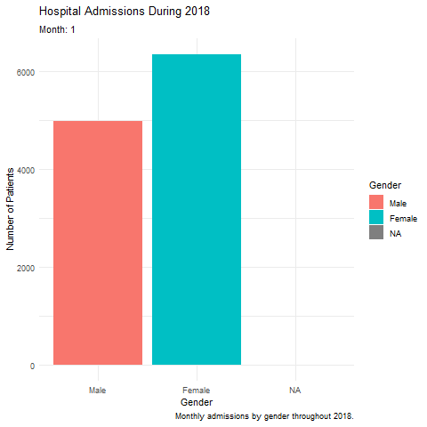{width="75%"}

## Part III: Predictive Modeling — Question 5

- Introduces the models used to classify hospital charges as low or high.

### Predicting hospital charges

The response variable was created from total hospital charges (`tot`):

- **Low:** total charge is below the median.
- **High:** total charge is at or above the median.

The decision tree (`rpart`) and random forest (`ranger`) were compared using 5-fold cross-validation. The model comparison graph shows both models with cross-validation accuracy of approximately **83%**. The random forest is marginally higher in the accuracy comparison, so it is the selected model.

## Question 5: Tuning the Models

- Explains how tuning choices affect cross-validation accuracy.

### Random forest tuning

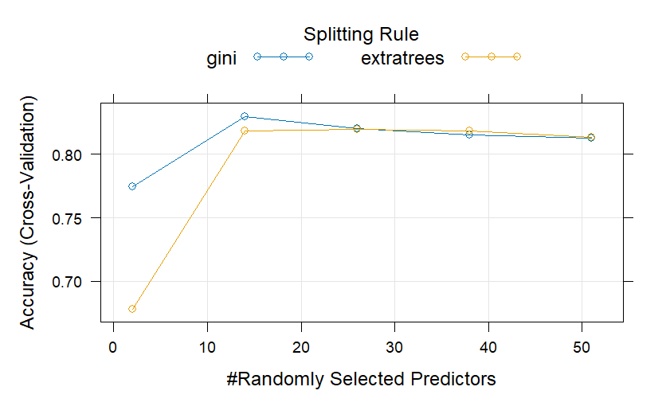{width="80%"}

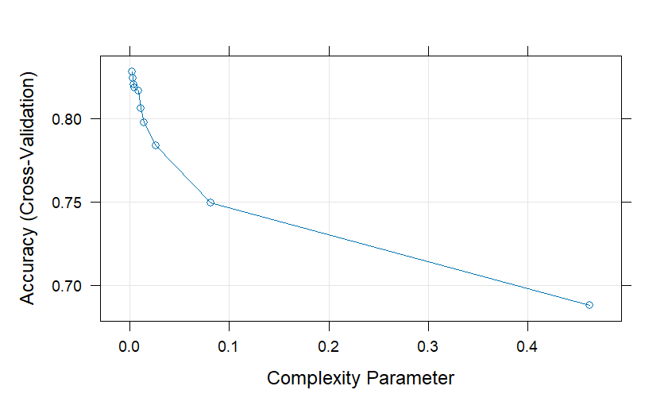{width="80%"}

The tuning plots show how cross-validation accuracy changes with the number of randomly selected predictors and the decision-tree complexity parameter. The selected settings should be those associated with the highest cross-validation accuracy.

## Question 5: Model Comparison

- Compares decision tree and random forest performance for hospital charges.

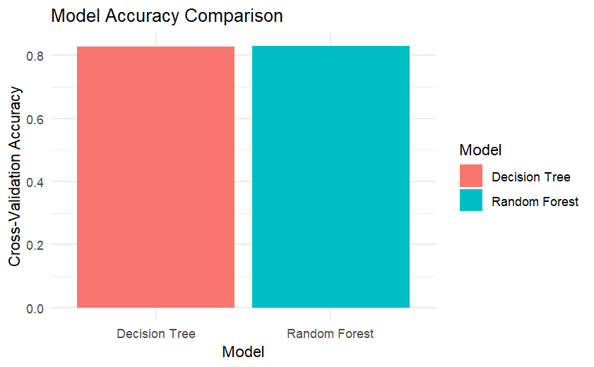{width="65%"}

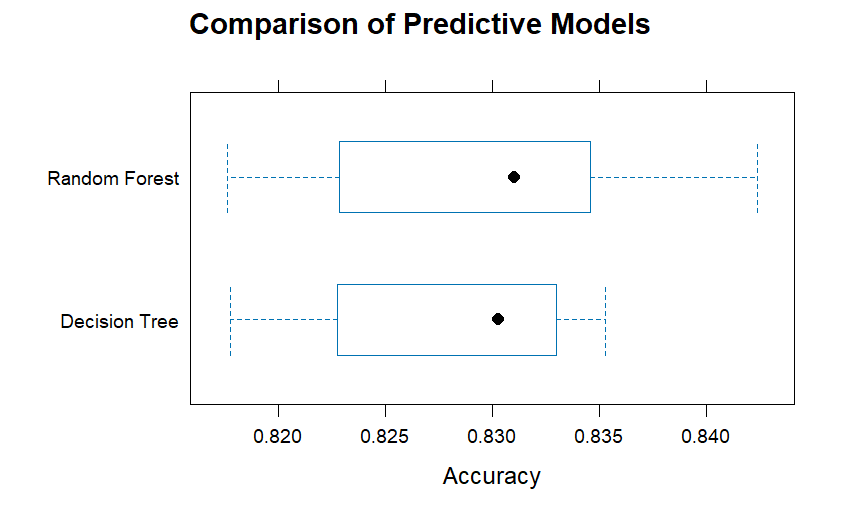{width="75%"}

Both models achieve similar cross-validation accuracy, around 0.83. The random forest has a very small advantage in the comparison, which is why it is selected. The difference is slight rather than a large improvement.

## Question 5: Decision Tree and Variable Importance

- Shows the charge decision tree and which predictors contribute most.

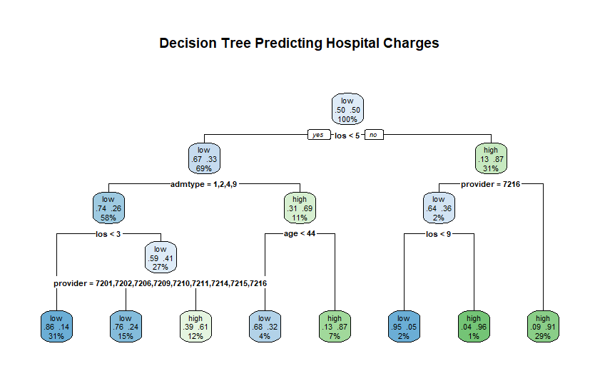{width="78%"}

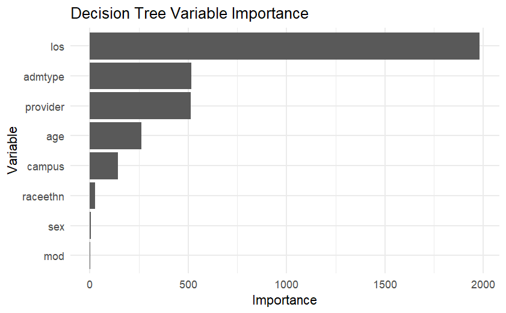{width="75%"}

The decision-tree graph illustrates how the tree separates patients into low- and high-charge groups using the predictors. Its variable-importance plot shows that **length of stay (`los`)** is by far the most important variable in the displayed decision tree. Admission type and provider also contribute, while the remaining variables have much smaller importance scores.

The `los` importance result is consistent with length of stay being strongly associated with total hospital charges. This is an association used by the model, not evidence that length of stay alone determines the charge.

## Question 5: Results and Interpretation

- Summarizes the selected charge model and the available performance evidence.

- **Selected model:** Random forest, based on its slightly higher cross-validation accuracy in the supplied comparison.
- **Cross-validation accuracy:** Approximately 83% (read from the supplied graph).
- **Testing accuracy:** Not displayed in the supplied Word document.
- **Confusion matrix:** Not included in the supplied Word document.

The cross-validation results indicate that both models classify the low- and high-charge groups with similar accuracy. The supplied figures do not show the test-set confusion matrix, so the number of low- or high-charge cases correctly classified—and whether one class was harder to predict—cannot be determined from these images alone.

## Part III: Predictive Modeling — Question 6

- Introduces the models used to classify hospital stays as short or long.

### Predicting length of hospital stay

The response variable was created from length of stay (`los`):

- **Short:** length of stay is below the median.
- **Long:** length of stay is at or above the median.

The original `los` variable was removed from the predictors after creating the target. This prevents the model from using the value it is supposed to predict.

The input variables were `age`, `sex`, `raceethn`, `provider`, `moa`, `mod`, `admtype`, and `campus`.

## Question 6: Model Comparison

- Compares decision tree and random forest accuracy for length-of-stay groups.

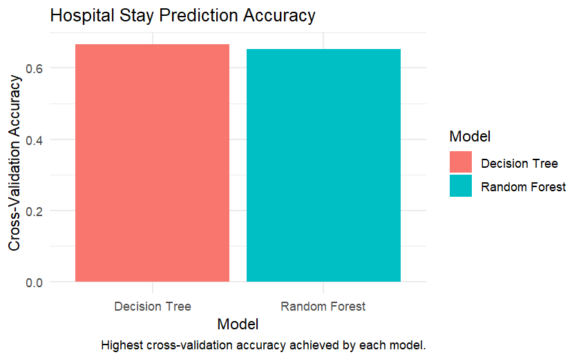{width="65%"}

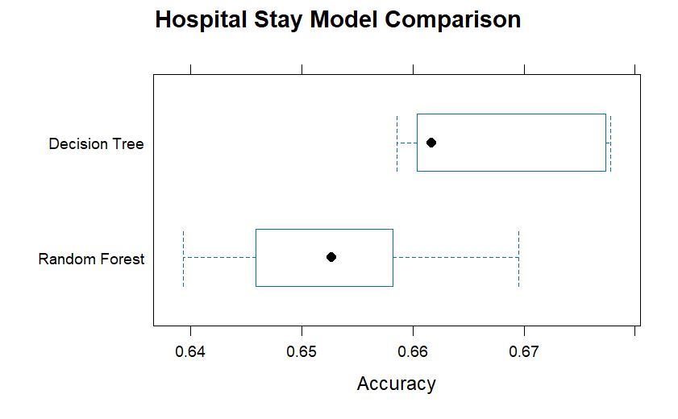{width="75%"}

The decision tree has the higher cross-validation accuracy in the supplied comparison, at approximately **67%**, compared with approximately **66%** for the random forest. The decision tree is therefore the selected model for predicting short versus long hospital stays.

The difference between the two models is modest, and both perform noticeably less accurately than the charge models.

## Question 6: Variable Importance

- Identifies the predictors that contribute most to stay classification.

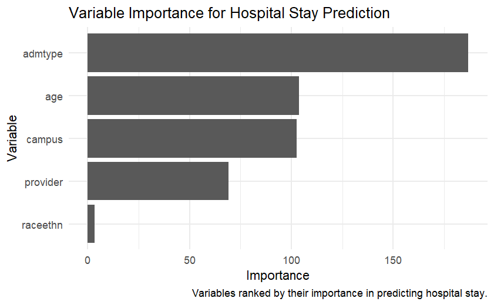{width="80%"}

The decision-tree variable-importance graph shows that **admission type (`admtype`)** is the most important predictor of hospital stay classification. Age and campus are the next most important variables, followed by provider. Race/ethnicity has relatively little importance in this displayed model.

## Question 6: Decision Tree

- Shows the decision rules used to classify short and long hospital stays.

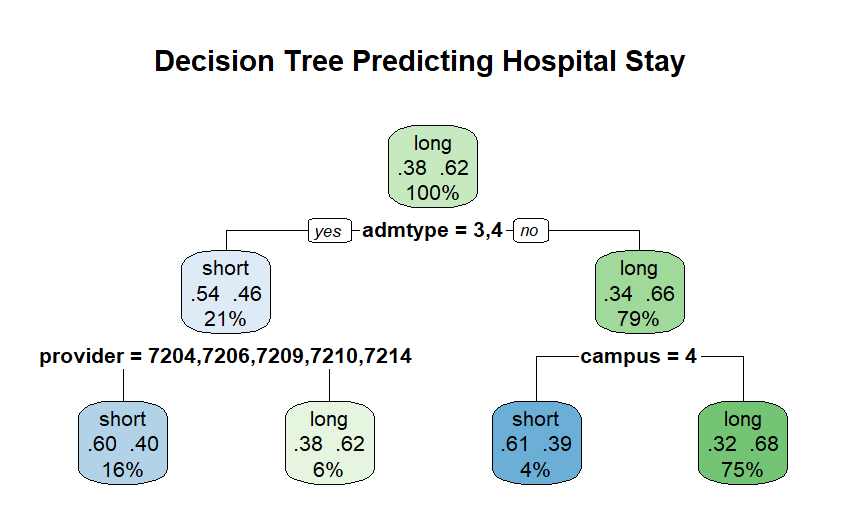{width="85%"}

The tree first splits on admission type. Later splits use provider and campus to further classify records as short or long stays. This suggests that the type of admission and the hospital campus/provider group are useful for distinguishing length-of-stay categories in this model.

## Question 6: Results and Interpretation

- Summarizes the selected length-of-stay model and its reported performance.

- **Selected model:** Decision tree, based on its higher cross-validation accuracy in the supplied comparison.
- **Cross-validation accuracy:** Approximately 67% (read from the supplied graph).
- **Median length of stay:** Not reported in the supplied Word document.
- **Testing accuracy:** Not displayed in the supplied Word document.
- **Confusion matrix:** Not included in the supplied Word document.

The decision tree performs only moderately better than chance-level classification for the two stay groups. Its accuracy is also lower than the approximately 83% cross-validation accuracy shown for the hospital-charge models.

## Part III: Question 7 — Summary and Comments

- Compares the findings from the hospital-charge and length-of-stay models.

- For **hospital charges**, the random forest has the slightly higher cross-validation accuracy, at approximately 83%.
- For **length of stay**, the decision tree has the higher cross-validation accuracy, at approximately 67%.
- The charge models perform better than the stay models in the supplied cross-validation comparisons.
- Length of stay is the strongest variable in the displayed charge decision tree.
- Admission type is the strongest variable in the displayed length-of-stay decision tree.
- The model comparisons show that the best model depends on which outcome is being predicted.

The graphs support a comparison of cross-validation performance and variable importance. Exact test accuracies, confusion matrices, and the median length of stay were not included in the Word document, so those values should be added from the R output before presenting final test-set conclusions.

## Challenges and Limitations

- Highlights data preparation and evaluation limits that affect interpretation.

- The data required cleaning and handling missing values before modeling.
- Rows with blank `raceethn` or `admtype` values were excluded from the predictive modeling data.
- The length-of-stay target was derived from `los`, so `los` was removed from the predictors to avoid target leakage.
- The 10:90 training/testing split follows the assignment instructions, but provides less training data than a more typical split.
- The supplied model graphs show cross-validation comparisons but do not include the test confusion matrices or exact test accuracies.

## Conclusion

- Recaps the main visualization and predictive-modeling findings.

The visualizations summarize hospital admissions, patient characteristics, length of stay, and hospital charges in Rhode Island during 2018. For predictive modeling, the random forest performed slightly better for classifying hospital charges, while the decision tree performed slightly better for classifying length of stay. The charge models had higher cross-validation accuracy overall. The variable-importance and tree plots also show that different predictors contribute to the two prediction tasks.

## Questions

- Invites questions about the data, visualizations, and predictive models.

Thank you!
